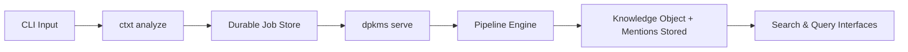

# CLI API (`ctxt` and `dpkms`)

ContextHelp provides two command-line interfaces that together expose all engine capabilities:

- **`ctxt`** — User-facing commands for capture, search, composition, and profiles
- **`dpkms`** — Infrastructure commands for server operations and maintenance

Both CLIs support ingestion, job queue management, retrieval, registry interactions, entity/mention resolution, focus profiles, and local server operations. There is no plugin system ([ADR-078](../decisions/ADR-078-no-plugin-system.md)): nothing adds commands at runtime.

Both CLIs are:

- Local-first
- Deterministic given config + input
- Scriptable
- Fully offline-capable
- Parallel to REST and gRPC APIs

All ingestion operations follow the **Transactional Outbox Model**:
`ctxt analyze` enqueues a job → the worker (`dpkms serve`) processes pipelines → results are written to storage.



---

## Installation

```bash
brew install contexthelp
```

or:

```bash
curl -sL https://context.help/install.sh | bash
```

This installs both `ctxt` and `dpkms` binaries.

Development build:

```bash
go build -o ctxt cmd/ctxt/main.go
go build -o dpkms cmd/dpkms/main.go
```

---

## Command Overview

### `ctxt` Commands (User-Facing)

| Command | Purpose |
|--------|---------|
| `ctxt <content>` | (Default) Enqueue content for ingestion (args, stdin, or clipboard) |
| `ctxt analyze` | Enqueue an ingestion job (supports clipboard fallback) |
| `ctxt inbox` | Manage inbox items (list, triage, discard, clear) |
| `ctxt list` | Query knowledge objects on the dpkms instance |
| `ctxt find <query>` | Semantic search (supports clipboard fallback) |
| `ctxt show <id>` | Display knowledge object details (supports clipboard fallback) |
| `ctxt export <id>` | Print a knowledge object as JSON or YAML |
| `ctxt delete` | Remove knowledge objects |
| `ctxt edit` | Modify knowledge object metadata |
| `ctxt reprocess` | Re-run an enrichment step on an object, as a dpkms job |
| `ctxt link` | Create, list and delete typed links between objects |
| `ctxt profile` | Manage focus profiles |
| `ctxt compose` | Generate compositions (briefs, plans) |
| `ctxt stats` | Live at-a-glance system summary |
| `ctxt page` | Entity pages (list, show, refresh) |
| `ctxt index` | Show or rebuild the topic index |
| `ctxt instance` | Multi-instance targeting (use, list, current) |
| `ctxt config` | Configuration operations |
| `ctxt registry` | Manage registries |
| `ctxt entity` | Query and inspect entities |
| `ctxt uri` | Manage ctxt:// URI scheme OS registration |

### Output formats of list commands

List commands (`list`, `feed list`, `entity list`, `registry list`, `audit list`, `cursor list`, `inbox list`, `instance list`, `page list`, `link list`, `remind list`, `watch status`, `job list`, `profile list` and the others) take `--format json|yaml|table|csv|text`. `json` and `yaml` print the full records. `table`, `csv` and `text` print one row per item with the same columns, and `--cols` selects and orders them. These row views carry no title, count or footer line, and an empty CSV result is the header line alone. Without `--format`, a list command prints its human view.

### Next-step hints

After a successful run, `analyze`, `feed add`, `profile create`, `import <source>`, `import batch` and `watch start` print a one-line hint naming the usual next command. Hints print only on a terminal in table format. `--no-hints`, `--quiet` or `HOP_QUIET_HINTS=1` turn them off; `--format json|yaml` and piped output never show them. An import run with `--dry-run` prints none.

### `dpkms` Commands (Infrastructure)

| Command | Purpose |
|--------|---------|
| `dpkms serve` | Start background worker + REST/gRPC APIs |
| `dpkms ps` | List all running dpkms instances |
| `dpkms shutdown` | Gracefully stop a running instance (alias: `stop`) |
| `dpkms reboot` | Gracefully restart a running instance (SIGHUP) |
| `dpkms housekeeping` | Database maintenance and optimization |
| `dpkms job` | Inspect/manage ingestion jobs |
| `dpkms secret` | Manage secrets (get, set, list backend) |

### Version and Verbose Flags

Both CLIs expose `--version` (`-v`) as a root flag and `--verbose` (`-V`) as a persistent flag:

```bash
ctxt --version   # or: ctxt -v
dpkms --version  # or: dpkms -v

ctxt --verbose search "foo"   # or: ctxt -V search "foo"
```

Output format: `<binary> version <semver> (<YYYY-MM-DD>)`. See [docs/conventions/version-output.md](../conventions/version-output.md).

---

## `ctxt analyze`

Enqueue content into the ingestion queue.
This does **not** run pipelines directly; the worker handles execution.

**If no content is provided as an argument or via piped stdin, `ctxt` (and `ctxt analyze`) will check the system clipboard.**

### Usage

```bash
ctxt <content> <options>
# or explicitly:
ctxt analyze <content> <options>
```

### Options

| Flag | Description |
|------|-------------|
| `--type <text|url|image|audio|video|feed|auto>` | Input type override |
| `--hints "<#hint #hint>"` | Influence tagging |
| `--mentions "<@slug1 @slug2>"` | Explicit mentions to attach |
| `--file <path>` | Read input from file |
| `--profile <name>` | Use focus profile |
| `--pipeline <name>` | Force pipeline |
| `--lang <code>` | Input language override |
| `--translate none` | Skip translations |
| `--raw` | Disable AI; store raw knowledge object |
| `--wait` | Block until job completes |
| `--output <json|yaml|id>` | Output format |

### Notes

- Returns a **Job ID**.
- With `--wait`, returns the resulting **Knowledge Object ID**.
- Content goes only to the one instance ctxt resolves (see [Resolution order](#resolution-order)). Nothing is queued on this machine and no other instance is tried.
- Exit status: `70` nothing answered at the instance, `5` the instance rejected the token (not retried; a `reader` token lacks `write:objects`), `2` the instance refused the request (a `422` names the unrouted type or pipeline), `6` a server error.

### Examples

```bash
# Default behavior: capture clipboard
ctxt

# Direct argument
ctxt "Fix signup flow" --hints "#ux"

# Piped stdin
echo "UX improvements needed" | ctxt --mentions "@ui.best-practice"

# Explicit command with file
ctxt analyze --file screenshot.png --type image
```

---

## `ctxt inbox`

Manage inbox items — captured content parked for a triage decision before entering the pipeline.

Inbox items are created when content is captured via `ctxt analyze` with the `--inbox` flag, the
PWA Web Share Target, or any other capture path that defers pipeline scheduling.

### Commands

```bash
ctxt inbox list                      # list pending inbox items
ctxt inbox triage <id>               # promote to active and enqueue for processing
ctxt inbox triage <id> --pipeline <name>  # triage with a specific pipeline
ctxt inbox discard <id> --confirm-token=<token>  # mark item as discarded
ctxt inbox clear --confirm-token=<token>         # discard all inbox items
```

Every subcommand calls the dpkms API of the resolved instance (`--server`, `--instance`, `CTXT_INSTANCE`, `ctxt instance use`, then config); nothing reads the local store. `list` needs the `read:inbox` scope; `triage`, `discard` and `clear` need `process:inbox`, which only an `admin` token holds. A `writer` or `reader` token exits 5, an unreachable instance exits 70 and an unknown item ID exits 3.

### `inbox list` Options

| Flag | Description |
|------|-------------|
| `--limit <n>` | Max results (default: 50) |
| `--offset <n>` | Pagination offset |
| `--before <RFC3339>` | Created before |
| `--after <RFC3339>` | Created after |
| `--pending` | Queue view: pending and running jobs |
| `--failed` | Queue view: failed jobs |
| `--raw` | Queue view: raw (unenriched) objects |
| `--output json` | JSON output |

`--pending`, `--failed` and `--raw` switch to the queue view (`GET /api/v1/inbox/queue`) and combine; `--before` and `--after` apply to the inbox view only.

### `inbox triage` Options

| Flag | Description |
|------|-------------|
| `--pipeline <name>` | Pipeline to use (default: auto-detect from content) |

### Notes

- `triage` promotes the item to `active` status, then enqueues a job. Returns the **Job ID**.
- `discard` marks the item as `discarded`; it is excluded from all future queries.
- `clear` discards every current inbox item and prints the count cleared.
- `discard` and `clear` are destructive: they need `--confirm-token`. Run them once without it and the refusal prints the token.

### Examples

```bash
# See what's waiting
ctxt inbox list

# Triage a specific item
ctxt inbox triage 4a3b1c2d --pipeline text.long

# Discard noise
ctxt inbox discard 9f8e7d6c --confirm-token=<token>

# Nuke everything
ctxt inbox clear --confirm-token=<token>
```

---

## `dpkms job`

Inspect and control ingestion jobs. ctxt has no job command.

### Commands

```bash
dpkms job list [--state pending|running|completed|failed|cancelled] [--limit N]
dpkms job status <id>
dpkms job log <id>
dpkms job retry <id>
dpkms job cancel <id>
```

---

## `ctxt list`

Query the knowledge objects of the dpkms instance ctxt resolves (`--server`, `--instance`, `CTXT_INSTANCE`, `ctxt instance use`, then config). Filters go to `GET /api/v1/objects`, `--facets` also calls `GET /api/v1/objects/facets`, and `--q` calls `GET /api/v1/search`. All need `read:objects`. ctxt never opens a local store.

### Usage

```bash
ctxt list <filters> <options>
```

### Filters

Filters combine with AND.

| Flag | Description |
|------|-------------|
| `--type <type>` | Knowledge object type |
| `--subtype <name>` | Subtype |
| `--tagged <tag>` | One tag. Match several with `--q "tag=in=(a,b)"` |
| `--mention <@ns.slug>` | Mention (`@ns.slug` or `ctxt://` URI) |
| `--pipeline <name>` | Pipeline |
| `--status <s>` | `active` (default), `inbox`, `discarded`, `raw` or `all` |
| `--after <date>` / `--before <date>` | Created on or after / on or before: `YYYY-MM-DD` (midnight UTC) or RFC 3339 |
| `--meta-type <type>` | Metadata type (e.g. `observation`, `task`) |
| `--topic <t>` / `--person <p>` / `--source-type <s>` | Metadata topic, person, source type |
| `--since <date>` / `--until <date>` | A date mentioned in the content falls in the range: `YYYY-MM-DD` |
| `--q "<rsql>"` | RSQL query answered by the instance's search, instead of the filters |

### Options

| Flag | Description |
|------|-------------|
| `--limit <n>` | Max results (default 50; 0 returns every match) |
| `--start <offset>` | Pagination offset |
| `--sort <key>` | `created` (default; `recent` is a synonym) or `updated` |
| `--dir <asc\|desc>` | Sort direction (default `desc`) |
| `--facets` | Also print counts by metadata type |
| `--cursor <name>` / `--advance` | Named cursor, kept in a client file: list only objects created since the cursor's last position, oldest first; `--advance` moves it |
| `--format json\|yaml` | Structured output |

A malformed date, several tags in `--tagged`, or an unknown `--sort` / `--dir` value exits 2. An unreachable instance exits 70, a refused token 5.

---

## `ctxt find`

Search knowledge on the dpkms instance: full-text, vector or hybrid (the default).

**If no query is provided, `ctxt find` will check the system clipboard.**

### Usage

```bash
ctxt find <query> <options>
```

### Options

| Flag | Description |
|------|-------------|
| `--fts`, `--semantic`, `--hybrid` | Mode: full-text, vector or hybrid. Default: the profile's `search_strategy.mode`, else `search.default_mode` |
| `--profile <name>` | Search only the objects this profile owns, with its `search_strategy` |
| `--limit <n>` | Max results (default 10) |
| `--rrf-k`, `--fts-weight`, `--vector-weight`, `--fts-pool`, `--vector-pool`, `--min-score` | Override one search knob for this run |
| `--meta-type`, `--topic`, `--person`, `--source-type`, `--since`, `--until` | Metadata filters; dates as `YYYY-MM-DD` |
| `--explain` | Per-result score breakdown (hybrid only) |
| `--facets` | Metadata type counts over the filtered objects |
| `--graph` | The search trace as a graph (see `ctxt find --help`) |
| `--server <url>` | dpkms instance to search; overrides `--instance` and config |
| `--format json\|yaml` | Structured output |

- **How it runs.** `find` sends `POST /api/v1/find` (`read:objects`, every role) to the instance `--server`, `--instance`, `CTXT_INSTANCE` or `ctxt instance use` selects. It never opens a local database.
- **Settings travel with the query.** ctxt resolves the search strategy (global `search`, then the active profile's `search_strategy`, then the flags) and sends every knob. The active profile (`--profile` or `profile.default`) scopes the search to its objects.
- **Query embedding** runs on the dpkms host, with its default embedding model and provider settings. The `--embedding-*` flags apply to `--graph` only; without it they exit 2.
- **Exit codes.** Unreachable 70, 401/403 5, a bad filter date or a semantic leg that cannot run with `search.fallback_to_fts: false` 2, a dpkms error 6.
- **`ctxt://search/<query>`** runs the same search.

---

## `ctxt show`

Display a knowledge object's details, read from the dpkms instance (`GET /api/v1/objects/{id}`), with the objects related to it through shared mentions (`GET /api/v1/objects/{id}/related`). Needs `read:objects`.

**If no ID is provided, `ctxt show` will check the system clipboard for an object ID.**

```bash
ctxt show <id> [--raw] [--format json|yaml]
```

`--raw` and `--format` print the object itself. An unknown ID exits 3, an unreachable instance 70, a refused token 5.

---

## `ctxt export`

Print a knowledge object read from the dpkms instance (`GET /api/v1/objects/{id}`) as JSON, or YAML with `--format yaml`. Same exit codes as `ctxt show`.

```bash
ctxt export <id> [--format yaml]
```

---

## `ctxt classify`

Run classification on text, or on an object when the argument starts with `o-`. The object is read from the dpkms instance (`GET /api/v1/objects/{id}`); classification runs in the ctxt process on its first summary, else its text, else its raw content.

```bash
ctxt classify "<text>"
ctxt classify <o-id>
```

---

## `ctxt delete`

Delete knowledge objects on the dpkms instance, by ID or by filter.

### Usage

```bash
ctxt delete <selector> --confirm-token=<sha>
```

### Selectors

| Flag | Description |
|------|-------------|
| `--id <id>` | Delete one object |
| `--tagged <tag>` | Delete the active objects carrying the tag |
| `--mention <@ns.slug>` | Delete the active objects mentioning the entity |
| `--type <type>` | Delete the active objects of the type |
| `--all` | Delete every active object |

`--tagged`, `--mention` and `--type` combine with AND. `--id` wins over the filters, and `--all` over `--tagged`, `--mention` and `--type`.

- **Admin only.** Deleting needs `delete:objects`, which only the `admin` role holds. A `writer` or `reader` token exits 5 and deletes nothing.
- **How it runs.** A filter lists its matches with `GET /api/v1/objects`, then deletes each one with `DELETE /api/v1/objects/{id}`. A 401 or 403 stops at the first refused request; an object deleted by someone else in the meantime is noted and skipped. Any other failed delete makes the command exit non-zero after the rest have run.
- **Confirmation.** kit's `--confirm` policy applies: the command refuses without `--confirm-token=<sha>` and prints the token to echo back.
- **Preview.** `--dry-run` prints the plan: the objects a committed run deletes. `--confirm=no` prints the same targets as a refusal. Neither deletes anything, and both need only a read token.
- **Exit codes.** Unreachable instance 70, 401/403 5, unknown `--id` 3, no selector 2.

---

## `ctxt edit`

Modify a knowledge object's metadata on the dpkms instance (`PATCH /api/v1/objects/{id}`; needs `write:objects`, held by `writer` and `admin`).

```bash
ctxt edit <id> <fields>
```

Editable fields:

| Flag | Field |
|------|--------|
| `--title <text>` | Replaces the summaries with this title. `list` and `show` print the first summary as the title |
| `--summary <text>` | Replaces the first summary and keeps the others |
| `--tags <t1,t2>` | Replaces the tags |
| `--mention "<@m1 @m2>"` | Replaces the mentions |
| `--subtype <name>` | Replaces the subtype |

`--title` and `--summary` both set the first summary, so they can't be combined (exit 2). No field is exit 2, an unknown ID exit 3, a reader token exit 5.

---

## `ctxt reprocess`

Queue a job on the dpkms instance that re-runs one enrichment step on an object and writes the result back (`POST /api/v1/objects/{id}/reprocess`; needs `write:objects`).

```bash
ctxt reprocess <id> [--step structured_metadata|entity_extractor|tagger]
```

- The step runs where dpkms runs, with that instance's providers and configuration. ctxt only queues it and prints the job ID; `--format json` prints `{id, step, job_id, status: "queued"}`.
- `--step` defaults to `structured_metadata`. An unknown step exits 2, an unknown ID 3, a reader token 5.
- The job's type is `object:reprocess`. Once it completes, `ctxt show <id>` shows the result.

---

## `ctxt link`

Typed links between two objects, stored on the dpkms instance.

```bash
ctxt link create <source_id> <target_id> --type <type> [--context "<reason>"]
ctxt link list <object_id> [--type <type>] [--follow 1-3]
ctxt link delete <source_id> <target_id> --confirm-token=<sha>
```

- **Types:** `extends`, `contradicts`, `supersedes`, `supports`, `related-to`, `derived-from`, or an inverse name such as `extended-by`. dpkms stores the reverse edge with each link (`extends` gets `extended-by`), except for the symmetric `related-to`, and deletes the two together.
- **create** (`POST /api/v1/edges`) needs `write:objects`. An unknown type exits 2, an unknown object 3.
- **list** (`GET /api/v1/objects/{id}/edges`) needs `read:objects`. Without `--follow` it prints every edge in and out of the object, with its context. `--follow N` walks N hops (at most 3) and prints each object once. An unknown object exits 3.
- **delete** (`DELETE /api/v1/edges`) removes every link between the two objects, both directions. It needs `delete:edges`, which only the `admin` role holds: a `writer` token exits 5 and deletes nothing.

---

## `ctxt profile`

Manage focus profiles.

### Commands

```bash
ctxt profile list
ctxt profile view <name>
ctxt profile create <name> --config <path>
ctxt profile rm <name> --confirm-token=<sha>
ctxt profile set <name>
ctxt profile unset <name>
ctxt profile schema evolve <name>
```

`ctxt profile schema evolve` reads the 100 most recently created objects from the dpkms instance (`GET /api/v1/objects`, `read:objects`) and suggests entity types and topics the profile's schema lacks. The analysis runs in the ctxt process; the schema is not changed.

---

## `ctxt compose`

Generate a composition from knowledge objects. ctxt reads the 100 most recently created objects the filters select from the dpkms instance (`GET /api/v1/objects`, `read:objects`) and renders them locally.

### Usage

```bash
ctxt compose <type> <options>
```

### Types

| Type | Description |
|------|-------------|
| `brief` | Generate executive brief |
| `plan` | Generate action plan |
| `summary` | Generate summary |
| `draft` | Generate publish-ready draft |

### Options

| Flag | Description |
|------|-------------|
| `--mention <@slug>` | Objects that mention the entity |
| `--tagged <tag>` | Objects carrying one tag |
| `--since <date>` / `--until <date>` | Created on or after / on or before: `YYYY-MM-DD` or RFC 3339 |
| `--export markdown\|json` | Output format; `json` includes structured citations |
| `--no-citations` | No inline `[ref:ID]` markers |
| `--output-file <path>` | Write to file |

An unknown type, a malformed date or several tags exit 2. An unreachable instance exits 70, a refused token 5.

---

## `dpkms serve`

Start REST API, gRPC API, and the background job worker.

```bash
dpkms serve <options>
# aliases: dpkms start
```

### Options

| Flag | Description |
|------|-------------|
| `--name <slug>` | Instance name (URI-safe, e.g. `work`); derived from DB basename if omitted. Must be unique across running instances |
| `--port <number>` | HTTP port (default: 8080; auto-assigns if busy) |
| `--grpc-port <number>` | gRPC port (default: 9090; auto-assigned if busy) |
| `--cookie-bridge-port <number>` | Browser-extension cookie bridge port, loopback only (default: 9377; auto-assigned if busy; `0` = OS-assigned) |
| `--daemon` | Detach from terminal (background daemon) |
| `--profile <name>` | Default focus profile (interactive picker if unset and multiple exist) |
| `--public` | Allow remote connections |
| `--config <path>` | Custom config file |
| `--workers <n>` | Number of worker threads |
| `--dev` | Enable CORS for Vite dev server (localhost:5173) |
| `--reminder-interval <duration>` | How often to check for due reminders (default: 1m) |

### Notes

- gRPC and cookie-bridge ports are auto-assigned if the preferred port is busy.
- `--daemon` re-execs the process detached from the terminal; stdio is redirected to `/dev/null`.
- A pidfile is written to `$XDG_DATA_HOME/contexthelp/run/<port>.pid` on start and removed on clean shutdown.
- Stale pidfiles (from crashes) are cleaned up automatically by `dpkms ps`.
- On startup, stale/interrupted jobs are reset to `pending` for retry.
- SIGHUP triggers graceful drain + exit (for use with process supervisors or `dpkms reboot`).
- Starting a second instance with the same `--name` is a fatal error.

### Multiple instances

```bash
dpkms serve --name work     --config ~/.config/contexthelp/work.yaml
dpkms serve --name personal --config ~/.config/contexthelp/personal.yaml --port 8081
```

---

## `dpkms ps`

List all running dpkms instances on this machine.

```bash
dpkms ps [--output json]
```

Scans `$XDG_DATA_HOME/contexthelp/run/` for pidfiles, validates each process is alive, and removes stale entries automatically. A pid now held by a process that started after the pidfile's `started_at` (the pid was reused) is stale too; when the OS does not report a process's start time, the entry counts as alive.

Output columns: `NAME  PID  PORT  GRPC  DB  UPTIME` (BROWSER column added when any instance has browser enabled).

---

## `dpkms shutdown`

Gracefully stop a running dpkms instance (alias: `dpkms stop`).

```bash
dpkms shutdown [--port <number>]
dpkms stop     [--port <number>]
```

Sends SIGTERM to the target instance. The instance drains in-flight jobs, closes all servers, and exits.

| Flag | Description |
|------|-------------|
| `--port <number>` | Port of the instance to stop (default: `server.port`, overridden by `CH_SERVER_PORT`) |

---

## `dpkms reboot`

Gracefully restart a running dpkms instance.

```bash
dpkms reboot [--port <number>]
```

Sends SIGHUP. The instance drains in-flight jobs and exits. The caller (or process supervisor) is responsible for re-launching `dpkms serve`.

| Flag | Description |
|------|-------------|
| `--port <number>` | Port of the instance to restart (default: `server.port`, overridden by `CH_SERVER_PORT`) |

---

## `dpkms housekeeping`

Database maintenance, compaction, and optimization.

### Commands

```bash
dpkms housekeeping vacuum
dpkms housekeeping reindex
dpkms housekeeping compact
dpkms housekeeping prune --before <ISO>
```

---

## `ctxt stats`

Live at-a-glance system summary: knowledge objects (by type), jobs (by status), entities, feeds, profiles, pending reminders, and resurfacing candidates.

The counts come from `GET /api/v1/stats` on the dpkms instance `--server`, `--instance` or the config selects (scope `read:objects`); the server counts, nothing is listed. Profiles are this client's configuration, and the resurfacing count is the default profile's. Exit codes follow ADR-077: 70 when nothing answers, 5 without a valid token. `--watch` fails the same way on its first snapshot; later failures are printed and the next tick retries.

```bash
ctxt stats
ctxt stats --output json
ctxt stats --watch               # re-print every 3s; Ctrl-C to exit
```

| Flag | Description |
|------|-------------|
| `--watch` | Continuous refresh every 3 seconds |
| `--output json` | JSON snapshot (suitable for monitoring scripts) |

### JSON fields

| Field | Description |
|-------|-------------|
| `knowledge_objects` | Total object count |
| `objects_by_type` | Map of type → count |
| `jobs.total/pending/running/completed/failed` | Job counts by state |
| `entities` | Total entity count |
| `feeds` / `feeds_active` | Total and active feed count |
| `profiles` / `default_profile` | Profile count and active default |
| `reminders_pending` | Due or upcoming reminder count |
| `resurfacing_candidates` | Unseen resurfacing candidates of the default profile; `null` when the instance's storage has no resurfacing queue (Postgres) |

---

## `ctxt page`

Entity pages: compiled objects (type `entity_page`) that gather what the sources mentioning one entity say about it. Every leaf calls the dpkms instance `--server`, `--instance` or the config selects, through `/api/v1/pages`.

```bash
ctxt page list [--limit 50]          # newest first
ctxt page show person.alice
ctxt page refresh person.alice       # recompile from the page's sources
```

`list` and `show` need `read:objects`; `refresh` needs `write:objects` (`writer` or `admin`), and a `reader` token exits 5. An entity without a page exits 3. `--format json` prints the page objects.

---

## `ctxt index`

The topic index: object summaries grouped by the topics of `enrichment.structured_metadata`, read from `/api/v1/topic-index` on the selected instance.

```bash
ctxt index                 # every topic
ctxt index auth            # the first topic starting with "auth", ignoring case
ctxt index --refresh       # rebuild on dpkms, then print
```

Reading needs `read:objects`; `--refresh` needs `write:objects`. Before the first rebuild there is no index: `ctxt index` exits 3 and suggests `ctxt index --refresh`. A topic with no match prints `No entries for topic "<topic>"` (`[]` under `--format json`) and exits 0.

---

## `ctxt config`

### Commands

```bash
ctxt config show
ctxt config path
ctxt config validate
ctxt config edit
```

---

## `ctxt instance`

Pick the one dpkms instance `ctxt` commands talk to. An instance is either
a named `server.urls` entry (a URL plus its token, local or remote) or a
dpkms running on this machine, found through its pidfile by name or port.

```yaml
server:
  token: <default token>          # sent to entries without their own
  urls:
    - name: home
      url: https://dpkms.example.ts.net:7700
      token: <token for home>
    - name: laptop
      url: http://127.0.0.1:8080
```

A `name` is optional and unique: lowercase letters, digits and hyphens,
not all digits (a bare number selects a local instance by port).

### Commands

```bash
ctxt instance list              # named endpoints + running local instances; * marks the one in use
ctxt instance use home          # persist a named endpoint
ctxt instance use 8081          # persist a running local instance (stored by name)
ctxt instance use -             # clear the selection
ctxt instance current           # name, URL, layer that chose it, token: yes/no
```

The selection is persisted to `$XDG_DATA_HOME/contexthelp/run/current-instance`.
Tokens are never printed; `list` and `current` only say whether one is attached.
A password or `token=` parameter inside a URL (or a local instance's
connection string) prints masked, as `****` plus its last 4 characters.

### Per-call override (not persisted)

```bash
ctxt --instance home status
ctxt log --instance home
CTXT_INSTANCE=home ctxt feed list   # env var; same step as the flag
```

### Resolution order

Every command that talks to dpkms over its API (`status`, `log`,
`upgrade status`, `feed`, `import`, `capture`, `analyze`, `capture tabs`,
`capture history`, `list --q`) resolves exactly one endpoint:

1. `--server <url>`: the token of the `server.urls` entry with that URL, else `server.token`
2. `--instance` flag, else `CTXT_INSTANCE`
3. The current instance set by `ctxt instance use`
4. The first `server.urls` entry
5. `server.url`
6. `http://127.0.0.1:8080`

Steps 2 and 3 take a `server.urls` name first, then a running local
instance by name or port (as `http://127.0.0.1:<port>`, with the token of
a `server.urls` entry at that URL, else `server.token`). A name that
matches neither exits 70 and lists the configured names; a stale
`ctxt instance use` selection exits 70 too. Other `server.urls` entries
are reachable only by name or `--server`: when the resolved endpoint does
not answer, ctxt exits 70 and never tries another one.

Commands that still open the database directly (`stats`, `find`, `show`
and the rest) resolve `--instance` only to a running local instance's
database; a remote name fails with "no running dpkms instance" until they
move onto the API.

---

## `ctxt registry`

Manage registry subscriptions and metadata.

### Commands

```bash
ctxt registry list
ctxt registry add <name> <url>
ctxt registry delete <name> --confirm-token=<sha>
ctxt registry info <name>
ctxt registry sync <name>
ctxt registry pending [--registry <name>]
ctxt registry approve <id>... --confirm-token=<sha>
ctxt registry approve --all --registry <name> --confirm-token=<sha>
ctxt registry reject <id>...
```

`list` shows the cached registry manifests (what `add` and `sync`
fetched), not the config file's `registries` list; `ctxt config show`
prints that. `add` fetches and caches a registry's manifest (shown by
`list`); it does not write the config file. `sync`, `info`, `login` and `delete`
find a registry by name in the config file's `registries` list, so
subscribe by adding an entry there (`ctxt config edit`):

```yaml
registries:
  - name: uxpatterns
    url: https://uxpatterns.example.com
```

`sync` re-fetches the registry's manifest and replaces the cached copy.
When the manifest advertises `capabilities.entity_sync`, it also pulls
the entity index (`/entities/index`) into the local entity store; a
registry that serves steps only is never asked for entities. Entities
from a registry whose `trust_level` is not `trusted` (unset means
`untrusted`) are not written; `sync` reports them and still exits 0.
`--reconcile` applies each registry's `trust_level` the same way: only
trusted registries' entities take part in reconciliation.

- `untrusted`: the entities wait in the approval queue (`Entities not
  written from <name>: N pending approval (ctxt registry pending)`).
  `pending` lists them with an ID, the version, whether the registry's
  index signature was verified (`verified`, `unsigned`) and when sync
  first and last saw them. `approve` writes them as a trusted sync
  would (the registry's `sync_mode`), with metadata `provenance:
  approved from <name>` on full writes, and takes them off the queue;
  `reject` takes them off unwritten (the next sync queues them again
  while the registry still serves them). Nothing is written or dropped
  when an ID is not queued; a registry that is now `sandboxed` cannot
  have its queued entities approved. A later sync of a version already
  approved does not queue it again, and a new version replaces the
  queued one. `approve` is gated like `delete`: it needs the
  `--confirm-token` the refusal prints, and `--confirm=yes` alone is
  refused. `reject` needs no confirmation. `--dry-run` lists what
  either would touch. Setting `trust_level: trusted` and syncing
  again also writes them and empties the registry's queue.
- `sandboxed`: blocked (`N blocked`), never queued: a sandboxed
  registry never writes to the local graph.

---

## `ctxt entity`

Query and inspect entities (canonical concepts). Every leaf reads the dpkms instance `--server`, `--instance` or the config selects, through `/api/v1/entities` (scope `read:objects`). `search` matches a substring of the slug, title or an alias, ignoring ASCII case. An unknown slug exits 3.

### Examples

```bash
ctxt entity list
ctxt entity show <slug>
ctxt entity search "<query>"
ctxt entity backlink <slug>
```

---

## `dpkms secret`

Read and write secrets from the configured backend. ctxt has no secret command.

The active backend is set via `secrets.backend` in the config file. Supported backends: `env`, `keychain`, `age-file`, `1password`, `gh-secrets`. See [secrets-backends](../security/secrets-backends.md) for setup.

### Commands

```bash
dpkms secret get <key>       # Print secret value to stdout
dpkms secret set <key>       # Store a secret read from stdin, --from-file or --prompt
dpkms secret list            # List keys, or show the backend config when it cannot enumerate
```

### Notes

- `secret get` exits non-zero if the key is not found.
- `secret set` with the `env` or `age-file` backend fails with a clear error — these backends are read-only.
- `--format json` is supported for `get` (`{"key":"...","value":"..."}`) and `list`.
- `secret set` refuses a value passed as an argument (it would leak into shell history, `ps` and CI logs): pipe it on stdin, or use `--from-file` or `--prompt`.

### Examples

```bash
# Get a secret from the active backend
dpkms secret get OPENAI_API_KEY

# Store a secret (keychain backend required)
dpkms secret set OPENAI_API_KEY --prompt

# Show which backend is active and its config
dpkms secret list

# Machine-readable output
dpkms secret get OPENAI_API_KEY --format json
```

---

## `ctxt uri`

Register the `ctxt://` URI scheme with the OS so clickable links open ctxt.

### Subcommands

```bash
ctxt uri register                         # Register ctxt:// with OS (runtime)
ctxt uri snippet --platform <platform>    # Print static config snippet
```

Supported platforms for `snippet`: `macos`, `ios`, `linux`, `windows`.

### OS dispatch

After `ctxt uri register`, clicking a `ctxt://` link invokes:

```
ctxt ctxt://<objectID>          → ctxt open <objectID>
ctxt ctxt://search/<query>      → ctxt find <query>
```

### Platform notes

| Platform | Mechanism |
|----------|-----------|
| macOS | `LSSetDefaultHandlerForURLScheme` via bundle ID `com.ideacrafterslabs.ctxt` |
| Linux | `xdg-mime` + `.desktop` file |
| Windows | HKCU registry entry |
| iOS / bundles | Use `ctxt uri snippet --platform ios` — must be in `Info.plist` |

### Examples

```bash
# Register on current machine (requires ctxt installed)
ctxt uri register

# Print macOS plist snippet for app bundle packaging
ctxt uri snippet --platform macos

# Print Linux .desktop file
ctxt uri snippet --platform linux
```

---

## Exit Codes

ctxt uses kit's exit classes. With `--format json` the error envelope on
stderr names the class in `code`.

| Code | Class | Meaning |
|------|-------|---------|
| 0 | `OK` | Success |
| 1 | `GENERIC` | Failure ctxt does not classify |
| 2 | `USAGE` | Invalid flags, arguments or input |
| 3 | `NOT_FOUND` | The named object, entity, profile or registry does not exist |
| 4 | `CONFLICT` | The request conflicts with current state (name taken, policy veto) |
| 5 | `UNAUTHORIZED` | dpkms or a registry refused the request (401, 403), or no entitlement covers the namespace |
| 6 | `TRANSIENT` | A server error or dropped connection; a retry may work |
| 7 | `CONSENT_REFUSED` | A confirmation was declined |
| 64 | `RATE_LIMITED` | dpkms answered 429 |
| 70 | `PREREQUISITE` | Nothing answers at the dpkms endpoint |

dpkms status mapping: see ADR-077.

---

## Environment Variables

| Variable | Purpose |
|----------|---------|
| `CTXT_CONFIG` | Config path override |
| `CTXT_DATA_DIR` | Data directory override |
| `CTXT_PROFILE` | Default focus profile |
| `DPKMS_DATA_DIR` | dPKMS data directory override |
| `DPKMS_WORKERS` | Number of worker threads |
