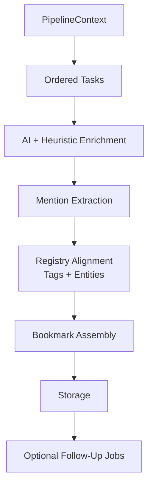
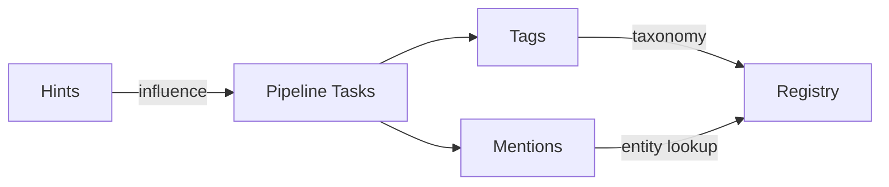
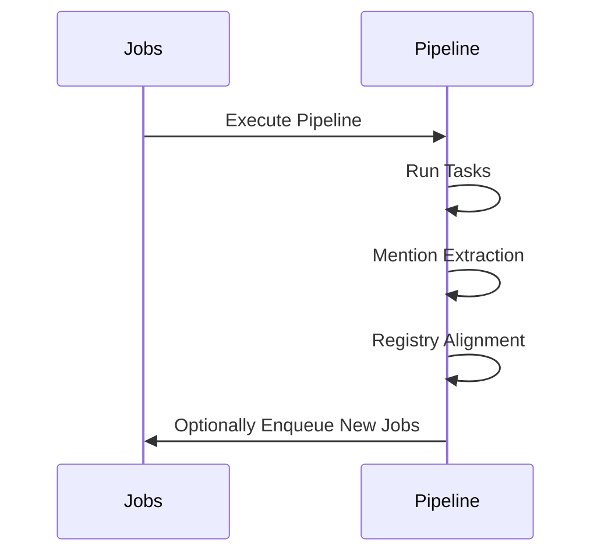

# Pipelines

Pipelines are the core processing units of ContextHelp. They transform raw, unstructured input into structured knowledge by applying ordered tasks such as inference, AI enrichment, metadata extraction, mention extraction, registry alignment, tagging, weighting, decision synthesis, and background job scheduling.

Pipelines are modular, deterministic and registry-aware. They execute inside the transactional **Jobs** system, ensuring resilience, traceability, and crash-safe resumption.

In addition to built-in pipelines, operators extend processing with pipeline overrides, custom pipelines and steps installed from registries (see [Extending pipelines](#extending-pipelines)). There is no plugin system ([ADR-078](../decisions/ADR-078-no-plugin-system.md)).

---

## Overview

A pipeline:

- Accepts a `PipelineContext` containing raw content, hints, mentions, registry state, and job metadata
- Executes a sequence of tasks (AI calls, heuristics, extraction routines)
- Produces a **Bookmark** (or additional `JobSteps`)
- Aligns output with taxonomies, entities, and weights from registries
- May enqueue follow-up background jobs
- Runs deterministically inside the jobs engine

---

## Pipeline Goals

- Normalize and structure multimodal inputs
- Extract and resolve **mentions** (`@entities`)
- Apply AI and heuristic enrichment
- Extract domain metadata, decisions, summaries, sections
- Align tags using taxonomies and weights
- Align mentions using entity registries
- Produce deterministic structured bookmarks
- Integrate tightly with the Jobs system
- Support localization/I18N

---

## Extending pipelines

Pipelines are extended without changing core code through:

- **Overrides**: `pipelines.overrides.<pipeline>` in config sets `providers`, `skip_steps` and `extra_steps` for a built-in pipeline.
- **Custom pipelines**: `dpkms pipeline create <file>` (or `POST /api/v1/pipelines`) defines a new pipeline from built-in and installed steps.
- **Installed steps**: `dpkms pipeline step install <name> --registry <url>` records a step from a step registry; installed steps are designed to run out of process ([ADR-058](../decisions/ADR-058-external-step-execution-protocol.md)), and no pipeline executes them yet.
- **Hooks** (accepted, not implemented yet): other applications will react before or after pipeline events through the external hook surface ([ADR-075](../decisions/ADR-075-external-hook-surface.md)).

---

## Relation Between Hints, Tags, and Mentions

**Hints**
- Influence pipeline behavior and weighting
- Never become tags
- Never become mentions automatically

**Tags**
- Emergent semantic classification
- Weighted, polarity-aware
- Normalized via taxonomies

**Mentions**
- Explicit canonical references
- Stored as stable entity slugs
- Resolved through registries
- Do not influence tag generation
- Represent identity, not classification

---

## Pipeline Types

### Text Pipelines

- `text.short`
- `text.long`

Includes mention extraction, semantic classification, registry alignment, etc.

### URL Pipelines

- `url.generic`
- `url.repo`

Extracts HTML/markdown, repo metadata, license, mentions, etc.

### Image Pipelines

- `image.landing`
- `image.ui`
- `image.ocr`

Performs OCR, heuristics, and passes extracted text to text pipelines.

### Audio Pipelines

- `audio.transcript`

Produces transcript → feeds into text pipeline tasks.

### Video Pipelines

- `video.youtube`
- `video.local`

Extracts transcripts, overlays, diagrams → feeds into enrichment and mention extraction.

---

## Mention Extraction Stage

All pipelines include a standardized mention stage.

### Responsibilities

- Detect `@identifier`
- Validate slug + namespace rules
- Lookup entities in:
  - local registry
  - remote registries (if configured)
- Produce resolved and unresolved mentions

### Guarantees

- Deterministic resolution
- No influence on tagging
- No merging with hints
- Works identically for custom pipelines

---

## Pipeline Lifecycle

All pipelines, built-in and custom, execute inside the Jobs system.

### Stages

#### Preprocessing

- type inference
- metadata extraction
- hint parsing

#### Task Execution

Tasks run in order:

- AI tasks
- heuristic tasks
- installed steps
- mention extraction
- weighting
- structural parsing

#### Registry Alignment

- tag normalization
- entity resolution
- taxonomy mapping

#### Follow-Up Jobs

Steps may schedule:

- feed ingestion
- entity graph operations
- deep scan jobs

---

## Pipeline Context

The `PipelineContext` contains:

- raw input
- inferred type/subtype
- hints
- resolved & unresolved mentions
- registry handles
- job metadata
- intermediate task outputs

---

## Lifecycle CLI

State-changing operations on pipelines run through `dpkms`:

| Subcommand | Purpose | `--note\|-n` |
|------------|---------|--------------|
| `dpkms pipeline create <file>` | Create from JSON/YAML/TOML config | optional |
| `dpkms pipeline remove <name>` | Delete a custom pipeline | **required** by default policy |
| `dpkms pipeline archive <name>` | Soft-disable a pipeline | **required** by default policy |
| `dpkms pipeline unarchive <name>` | Re-enable an archived pipeline | optional |

The `--note|-n` flag carries an audit explanation through the
`X-Ctxt-Note` HTTP header to the daemon, where the kit/runtime
policy engine evaluates it. Missing `--note` on a gated subcommand
returns exit code 4 (CONFLICT) with `POLICY_DENIED`.

See [policies.md](policies.md) for the rule schema, default bundle,
extension recipes, and how to override the gate temporarily.

---

## Testing Pipelines

Testing includes:

- built-in pipelines
- custom pipelines
- crash-recovery behavior
- deterministic replay tests

---

## Summary

Pipelines in ContextHelp:

- perform structured multimodal enrichment
- extract hints, tags, and mentions
- integrate with registries
- are deterministic and extensible through overrides, custom pipelines and installed steps
- schedule background jobs without core modification

Pipelines form the computational backbone of ContextHelp’s semantic engine.
