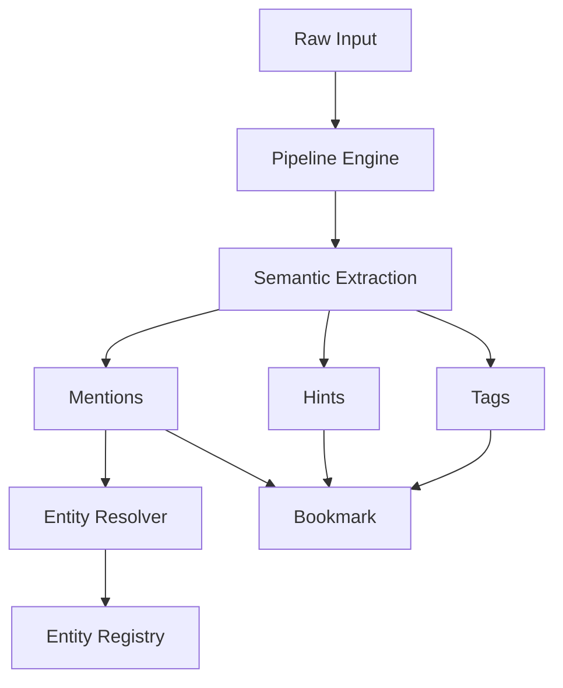

# KnowledgeObject Schema

> **Note (ADR-063):** The canonical type is `KnowledgeObject` (not "Bookmark"). The write
> source of truth for all structured content is `ObjectGraph` (`graph_json` column). Flat
> fields (`sections`, `tags`, `decisions`, `tasks`, `summaries`) are projection caches derived
> on read by `internal/projection`. Pipeline steps MUST write to `Graph.Nodes`; flat-field
> writes are treated as legacy. See `internal/storage/types.go` for the authoritative type.

This document describes the `KnowledgeObject` schema used by ContextHelp, including
**Mentions** and the **ObjectGraph** as first-class layers. KOs represent
enriched, structured, registry-aligned knowledge extracted from any input type.

They power retrieval, agent reasoning, semantic clustering, graph analysis, federated registry
alignment, and deterministic reproduction.

## Overview

A `KnowledgeObject` is a deterministic, JSON-serializable object produced by pipelines. All
fields follow strict semantics to ensure stability across runs, machines, registries and agents.

Below is the conceptual structure including the `mention_uris` field:

```json
{
  "id": "uuid",
  "createdAt": "2025-01-01T12:00:00Z",
  "lastMatchedAt": "2025-01-15T14:30:00Z",

  "type": "image",
  "subtype": "image.landing",
  "raw": "...",
  "source": "engine-cli",
  "pipeline": "image.landing",

  "contentHash": "a1b2c3...",
  "reinforcementCount": 1,
  "lastReinforcedAt": "2025-01-15T14:30:00Z",

  "title": "...",
  "summary": "...",
  "sections": [],
  "content": {},

  "tags": [],
  "decisions": [],
  "hints": [],
  "mention_uris": [],

  "related": [],
  "registry": {},
  "metadata": {},
  "debug": {}
}
```

## Conceptual Model



---

## ObjectGraph (write source of truth)

`KnowledgeObject.Graph` (`*ObjectGraph`) holds all structured intra-object content as typed
nodes and edges. Persisted in `objects.graph_json`. See ADR-063.

```json
{
  "graph": {
    "nodes": [
      {
        "id": "<objectID>/section/0",
        "node_type": "section",
        "label": "Hero Section",
        "content": "The hero section lacks clarity...",
        "order": 0
      },
      {
        "id": "<objectID>/tag/0",
        "node_type": "tag",
        "label": "ui.hero.antipattern",
        "order": 0
      }
    ],
    "edges": [
      {
        "id": "e1",
        "from_id": "<objectID>/section/0",
        "to_id": "<objectID>/tag/0",
        "edge_type": "derives_from"
      }
    ]
  }
}
```

Node types: `section`, `tag`, `entity_mention`, `decision`, `task`, `summary`, `code_block`

Edge types (intra-object only): `contains`, `references`, `resolves_to`, `derives_from`

Stable node ID format: `<objectID>/<nodeType>/<ordinal>` (0-indexed per type)
Node URI scheme: `ctxt:node/<objectID>/<nodeType>/<ordinal>`

### Representation nodes (media text)

Text derived from an image, audio, video, document or meeting original is stored as a
*representation node* (ADR-076). A `summary` representation is a `summary` node; every other
representation is a `section` node. The node's metadata carries `representation` (the kind) plus
provenance keys. Schema: `schemas/representation_node.json`. Go: `internal/representation`.

| Key | Meaning |
|---|---|
| `representation` | `caption`, `ocr`, `transcript`, `frame_caption`, `frame_ocr`, `summary` or `extracted_text` |
| `start_ms`, `end_ms` | time span within the original; `0` is a valid start |
| `speaker` | diarized speaker label; absent when not diarized |
| `page_number` | page within a document |
| `frame_index`, `frame_ms` | selected video frame and its timestamp; `frame_index` is required for `frame_caption` and `frame_ocr` |
| `image_index` | image embedded in a document |
| `provider`, `model` | backend and model that produced the text |
| `confidence` | 0-1, when the producer reports one |
| `origin` | `sidecar` for imported subtitles; absent otherwise |

Rules:

- Producers write nodes through `representation.Emit`, which allocates the next free ordinal for the
  node type (shared by all steps) and refuses unknown kinds, empty text, out-of-range values and
  reserved keys in `Extra`. A producer that returned nothing emits nothing.
- Each node has a `derives_from` edge **from the representation to the artifact node** of the stored
  original, when the graph has one. The original is `artifact/0`, owned by `blob.AttachOriginal`
  (which refuses to overwrite a node there that is not an original); steps never create artifact
  nodes for it. Later artifacts (kept frames, fan-out items, detected dependencies) take ordinals from 1
  up. Node ordinals are allocated by `storage.FreeOrdinal` (the lowest free ordinal of the type at or above
  the step's own position) in `representation.Emit` and in every step that adds nodes (`sectioner`,
  `heading_splitter`, `markdown_parser`, `textcleaner`, `feed_parser`, `fanout_items`,
  `dependency_enricher`, `tagger`, `entity_extractor`, `comment_extractor`, `language_detector`,
  `graph_extractor`).
- A summary representation at `summary/0` is not the object's root summary: `sectioner`,
  `heading_splitter` and `markdown_parser` hang their sections off the first plain summary instead
  (creating one at the next free ordinal), and `textcleaner` does not add a second `summary/0`.
- `Emit` is idempotent: a node with the same kind, anchor and content (speaker aside) is not added twice.
- A producer clamps invalid anchors (negative values become 0, an end before the start becomes the
  start) and skips a representation `Emit` still refuses, recording the reason as
  `<representation>_error` in object metadata. `Emit` itself is strict.
- `model` is recorded when the provider reports one (an optional `Model()` method; the Ollama, OpenAI,
  Anthropic, Gemini and OpenRouter vision and LLM providers do). `confidence` of 0 is treated as
  "none" and omitted.
- No root summary holds the whole text of a media object: the representation nodes are the text.
  The root `summary` node and its `contains` edges no longer exist for audio, PDF and DOCX objects, so
  graph queries filtered with `node_types=[summary]` or `edge_types=[contains]` return different
  results for these objects: transcript, page and caption nodes are `section` nodes, and a `summary`
  node appears only for the `summary` representation.
- The index projection, the document projection and the masked projection read text in the same
  order: plain summary and section nodes first, in graph order, then representation nodes: the `summary`
  kind, then the content kinds by node `order`, then frame kinds by `frame_index` (caption before OCR).
  Flat `sections` are never read when graph nodes exist.
- `sectioner` and `textcleaner` leave the graph of a draft that already holds a content representation
  node (any kind but `summary`) alone. `textcleaner` still cleans `RawContent`.
- Labels are 1-based for humans (`Segment 1`, `Frame 1 OCR`, `Page 1`); `frame_index`, `image_index`
  and ordinals are 0-based.

Flat fields (`sections`, `tags`, `decisions`, `tasks`) in the JSON below are projection caches
populated by the storage layer from `graph_json` on read. Do not treat them as write targets.

---

## Core Identification Fields

### id

Unique identifier for the bookmark.
**Type:** string (UUID v4 recommended)
**Generated by:** storage layer

### createdAt

Timestamp when the bookmark was created.
**Type:** ISO8601 string

### lastMatchedAt

Timestamp of last query match, used for ranking and sorting.
Automatically updated unless tracking is disabled.

---

## Input Classification

### type

High-level modality of the input.

Allowed values include core types:

- `text`
- `url`
- `image`
- `audio`
- `video`
- `other`

Other types are allowed (for example `"feed"` and `"feed_item"` from feed ingestion). They MUST be:

- lowercase
- namespaced or descriptive

### subtype

More granular pipeline-specific classification.

Examples:

- `text.short`
- `url.repo`
- `image.ui`
- `feed.fetch`
- `feed.parse`

### raw

Raw input payload or pointer.

### source

Origin of the input:
`engine-cli`, `rest-api`, `extension`, or a capture source name

### pipeline

Name of the pipeline that produced this bookmark, built-in or custom.

---

## Deduplication Fields

### contentHash

SHA-256 hash of normalized `raw` content + `source`, used for content-based deduplication.
**Type:** string (hex-encoded, 64 characters)
**Generated by:** worker after pipeline execution
**Uniqueness:** Enforced via partial unique index (non-empty values only)

Normalization: trim whitespace, lowercase, collapse multi-whitespace to single space. The hash input is `normalized_content + "\x00" + source`, so identical content from different sources produces different hashes.

### reinforcementCount

Number of times this content has been ingested. Starts at 1 on creation and increments on each re-ingestion of content with the same hash.
**Type:** integer (default: 1)
**Updated by:** `Reinforce` operation

Higher counts indicate frequently encountered content, useful for importance ranking.

### lastReinforcedAt

Timestamp of the most recent reinforcement (re-ingestion).
**Type:** ISO8601 string (nullable)
**Updated by:** `Reinforce` operation

Null when the bookmark has only been ingested once.

---

## Content Structure

### title

Human-readable title.

### summary

Semantic summary of content.

### sections

List of structured content segments with heading levels and embedded atomic notes.

```json
[
  {
    "title": "Architecture Overview",
    "content": "The system uses a two-layer pipeline model...",
    "level": 2,
    "notes": [
      {
        "content": "Pipeline execution is idempotent and deterministic",
        "source_location": "paragraph 2",
        "confidence": 0.9,
        "tags": ["architecture"]
      }
    ]
  }
]
```

Fields:
- `title` — Section title or heading (required)
- `content` — Section content (required)
- `level` — Heading level 1-6 (required)
- `notes` — Atomic notes extracted from this section (required, may be empty)

### content

Pipeline-defined structured data.

---

## Semantic Fields

### tags

AI-generated semantic labels aligned with registries.

Each tag is a structured object:

```json
[
  {
    "label": "ux.issue.signup",
    "namespace": "uxpatterns",
    "confidence": 0.92,
    "weight": 0.88
  }
]
```

Fields:
- `label` — Tag label (required)
- `namespace` — Taxonomy namespace from registry (optional)
- `confidence` — Confidence in tag assignment, 0.0-1.0 (required)
- `weight` — Importance weight (optional)

### decisions

Structured decision extractions from content.

Each decision is a structured object:

```json
[
  {
    "what_was_decided": "Use PostgreSQL for the primary datastore",
    "rationale": "Need strong ACID guarantees and complex query support",
    "impact": "HIGH",
    "status": "RESOLVED",
    "stakeholders": ["@person.sarah", "@person.mike"],
    "timestamp": "2025-01-15T00:00:00Z",
    "confidence": 0.92,
    "alternatives_considered": ["MongoDB", "DynamoDB"]
  }
]
```

Fields:
- `what_was_decided` — Clear statement of the decision (required)
- `rationale` — Why this decision was made (optional)
- `impact` — Severity/scope: `LOW`, `MEDIUM`, or `HIGH` (required)
- `status` — Lifecycle state: `OPEN`, `RESOLVED`, or `SUPERSEDED` (required)
- `stakeholders` — People or entities involved (required, may be empty)
- `timestamp` — When decision was made (optional)
- `confidence` — Confidence this is actually a decision, 0.0-1.0 (required)
- `alternatives_considered` — Other options considered (required, may be empty)

### questions

Open questions or areas needing clarification extracted from content.

```json
[
  {
    "question": "Should we support real-time sync?",
    "context": "Multiple stakeholders raised this during architecture review",
    "potential_answers": ["WebSockets", "SSE", "Polling"],
    "confidence": 0.85
  }
]
```

Fields:
- `question` — The open question (required)
- `context` — Why this question matters (optional)
- `potential_answers` — Possible answers if any are suggested (required, may be empty)
- `confidence` — Confidence this is a real question, 0.0-1.0 (required)

### hints

User-provided lightweight semantic signals.

Hints NEVER automatically become tags or mentions.

---

## Mentions

Mentions are **canonical references to stable entities** and form the backbone of graph reasoning.

### Structure

Mentions are stored as a flat list of typed URIs under `mention_uris`:

```json
"mention_uris": [
  "ctxt://entity/organization/anthropic",
  "ctxt://entity/project/mobile-app-redesign"
]
```

The URI format is `ctxt://entity/<namespace>/<slug>`. The human-readable input form `@namespace.slug` (e.g., `@organization.anthropic`) is accepted at API ingestion boundaries and converted to URIs internally by the pipeline.

`ctxt://` URIs are also OS-clickable after running `ctxt uri register` — clicking opens the object or triggers a search directly in ctxt. See [api-cli.md §ctxt uri](api-cli.md#ctxt-uri).

### Input form (API ingestion)

When submitting to `POST /analyze` or `POST /inbox`, use the legacy `mentions` field with `@`-prefixed slugs:

```json
"mentions": ["@organization.anthropic", "@project.mobile-app-redesign"]
```

The pipeline converts these to `ctxt://entity/...` URIs automatically.

### Guarantees

- stable identity
- user-editable
- resolvable via registries
- non-influential (do not affect tags)
- not automatically produced from hints

---

## Related

Semantically related bookmarks.

---

## Registry Alignment

Tracks registry versions, taxonomy sources, weights, and provenance.

---

## Metadata

Auxiliary metadata from pipelines and steps.

---

## Debug

Diagnostics and pipeline traces.

---

## Minimal Example

```json
{
  "id": "a1b2c3",
  "createdAt": "2025-01-01T12:00:00Z",
  "type": "text",
  "subtype": "text.short",
  "raw": "Fix signup flow friction",
  "contentHash": "e3b0c44...",
  "reinforcementCount": 1,

  "title": "Signup Flow Issue",
  "summary": "The signup flow has friction.",
  "tags": [
    { "label": "ux.issue.signup", "namespace": "uxpatterns", "confidence": 0.92, "weight": 0.88 }
  ],
  "hints": ["#ux", "#bad"],
  "mention_uris": [
    "ctxt://entity/concept/signup-flow"
  ],

  "pipeline": "text.short"
}
```

---

## Full Example

```json
{
  "id": "78d3e2d4-f144-47d8-b43b-9c8b0eab1515",
  "createdAt": "2025-01-18T12:45:00Z",
  "lastMatchedAt": "2025-01-19T08:12:33Z",

  "type": "image",
  "subtype": "image.landing",
  "raw": "<base64>",
  "source": "engine-cli",
  "pipeline": "image.landing",
  "contentHash": "7f83b16...",
  "reinforcementCount": 3,
  "lastReinforcedAt": "2025-01-19T08:00:00Z",

  "title": "Landing Page UX Review",
  "summary": "The hero section lacks clarity and value hierarchy.",

  "sections": [
    {
      "title": "Hero Section",
      "content": "The hero section lacks clarity and value hierarchy.",
      "level": 2,
      "notes": [
        {
          "content": "CTA is unclear and buried below the fold",
          "source_location": "hero section",
          "confidence": 0.88,
          "tags": ["ux", "cta"]
        }
      ]
    }
  ],

  "content": {
    "text": "Get started...",
    "components": []
  },

  "tags": [
    { "label": "ui.hero.antipattern", "namespace": "uxpatterns", "confidence": 0.95, "weight": 0.92 }
  ],

  "decisions": [
    {
      "what_was_decided": "Hero section CTA needs redesign",
      "rationale": "Unclear call-to-action reduces conversion",
      "impact": "HIGH",
      "status": "OPEN",
      "stakeholders": [],
      "timestamp": null,
      "confidence": 0.85,
      "alternatives_considered": ["Keep current CTA", "Remove CTA entirely"]
    }
  ],

  "hints": ["#ui", "#bad"],
  "mention_uris": [
    "ctxt://entity/concept/ui-best-practice",
    "ctxt://entity/concept/cta-weakness"
  ],

  "related": [
    { "id": "d9c3f8e", "score": 0.74 }
  ],

  "registry": {
    "taxonomy": ["uxpatterns"],
    "weights": ["ux-defaults"]
  },

  "metadata": {
    "image": { "width": 1440, "height": 900 }
  },

  "debug": {
    "taskTimings": {
      "OCR": 0.23,
      "ComponentDetect": 0.40
    }
  }
}
```

---

## Schema Evolution

- Additive changes permitted
- Breaking changes require schema version bump

---

## Summary

The Bookmark schema now formally supports:

1. **Mentions** — canonical entity references
2. **Content-hash deduplication** — SHA-256 based duplicate detection with reinforcement tracking
3. **Deterministic, extensible knowledge representations**
