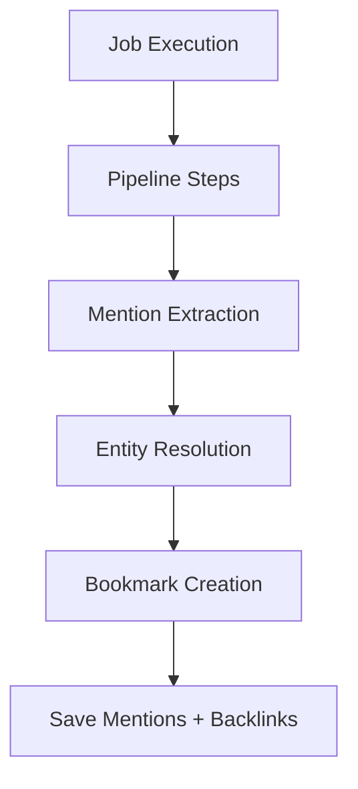

# Storage

The storage layer in ContextHelp gains new responsibilities with the introduction of **Mentions** and the **Entity Graph**.
While it continues to store bookmarks, jobs, traces, and tracking fields, it now additionally supports:

- **mention persistence**
- **entity resolution caching** (optional)
- **reverse lookup indexing** for entity → bookmark relationships

These enhancements preserve the system’s core principles of decentralization, determinism, extensibility, and local-first operation.

---

## Local-First Storage Philosophy

ContextHelp treats local storage as the canonical source of truth for:

- bookmarks
- ingestion jobs
- entity-resolution cache (optional)
- backlink index (entity → bookmarks)

Networked registries enrich the system but do not override or replace local data unless explicitly configured.

Key principles:

- **User Ownership** — All knowledge, including mentions, belongs to the user.
- **Offline First** — Mentions and entities remain usable without network connectivity.
- **Transparent & Inspectable** — Bookmarks and mentions are visible, exportable, and non-proprietary.

---

## Storage Responsibilities

The storage subsystem now handles:

- Persisting **bookmarks**, including:
  - tags
  - hints
  - **mentions**
  - **content hash** (SHA-256 for deduplication)
  - **reinforcement count** and **last reinforced timestamp**
- Maintaining the **entity–bookmark backlink index**
- Maintaining jobs and ingestion traces
- **Content-hash deduplication** — detecting duplicate content via normalized hash lookup
- **Reinforcement tracking** — merging metadata and incrementing encounter count on re-ingestion
- Supporting mention-based filtering and query evaluation

Storage does **not** handle:

- mention extraction (pipeline responsibility)
- entity resolution (resolver + registry client)
- refresh scheduling and feed fetching (jobs)
- ranking or reranking
- pipeline execution

These remain outside the storage layer.

---

## Write Path vs Read Path

ContextHelp maintains a strict architectural separation.

### Write Path (Ingestion + Pipelines)

Pipelines write:

- bookmark record
- mentions
- backlink entries

Flow:

```
Raw Input
 → Job Record
 → Pipeline Execution
 → Mention Extraction
 → Entity Resolution
 → Content-Hash Dedup Check
   → Match found: Reinforce (merge tags/mentions, increment count)
   → No match: Bookmark Creation
 → Backlink Index Update
```

The dedup check uses a SHA-256 hash of normalized content + source. If a match exists, the worker reinforces the existing bookmark (merging new tags and mentions) rather than creating a duplicate. A partial unique index on `content_hash` enforces integrity, and concurrent races are handled via constraint-violation fallback.

Only ingestion workers modify persistent state.

### Read Path (Search + Retrieval)

Query evaluation may include:

- metadata filters
- tag filters
- hint filters
- **mention filters**
- boolean logic
- text search

Storage returns local results; registry layers may merge or enhance them.

---

## Data Model Foundations

### Bookmarks

Bookmarks now include:

```
mentions: ["<entity-id>", ...]
```

`type` is free-form (`"feed"`, `"feed_item"`, ...); storage does not validate it.

Other core fields remain unchanged.

Mentions may reference:

- registry-provided entities
- user-defined local entities
- unresolved entity IDs

### Jobs

Jobs remain unchanged, but job steps may contain step diagnostic data or mention-resolution traces.

### Job Steps

Optional but useful for:

- mention extraction logging
- step debug output
- feed parsing diagnostics

---

## Entity–Bookmark Backlink Index

Local storage introduces or extends a lightweight backlink table enabling:

- efficient mention-based queries
- bidirectional graph navigation

A minimal model:

- `entity_id`
- `bookmark_id`

Backends may optimize or denormalize this.

---

## Storage Backends

`storage.type` selects the driver; `internal/storageutil/factory.go` accepts
only two values and fails startup on anything else.

| `storage.type` | `storage.path` | Vector search |
|---|---|---|
| `sqlite` (default) | database file | `sqlite-vec` `vec0` table, cosine distance |
| `postgres` | connection string | `pgvector`, cosine `<=>` |

Both drivers keep `mentions` as a JSON column on the object row (`JSON` on
SQLite, `JSONB` on PostgreSQL). Content above `storage.blob.threshold` is
written to the blob store set by `storage.blob.backend`: `local` (default),
`s3`, or `garage` (S3 with Garage defaults). `local` stores under
`storage.blob.local.path`, which defaults to `blobs/` in the data directory.
Every storage open (dpkms, and the CLI's direct paths) builds the store
through `blob.New`; there is no no-op blob store.

### Originals

Binary captures that reach the worker as a job payload (content that is not
valid UTF-8 or holds a NUL byte: images, audio, video, office and PDF files,
and legacy-charset text) are kept as originals, with no size cap. Point
`storage.blob` at S3-compatible storage if the local disk cannot hold them.
Not covered today: content a pipeline fetches itself (URL fetch) and the file
reader paths; those get no original.

- The worker stores the bytes in the blob store before any pipeline step
  runs, including steps that mask or scrub text. The stored original is the
  captured bytes, unmodified; only derived text passes through those steps.
- The blob key is the hex SHA-256 of the exact bytes. Identical originals
  share one blob, whatever their source.
- An `artifact` node (ordinal 0) records the original: `blob_key`,
  `content_type`, `size_bytes`, `sha256`, `file_name`. `content_type` is
  sniffed from the first 512 bytes. `file_name` is the last path segment of
  the capture's source, for display only. A source counts as a path when it
  holds a `/` or `\`, is a `file:` URL or a URL with a host, or is a watcher
  source (`watch:<mode>:<relpath>`, a bare name included). Labels (cli,
  stdin, clipboard, `v1.2`, an email address), other schemes (`mailto:`,
  `ambient:`) and sources ending in a separator give an empty name. Control
  characters (C0, C1, DEL) and Unicode format characters (including the
  bidi overrides) are removed, and the name is capped at 255 bytes.
- `metadata.original_blob_key` names the same blob at object level. It is
  separate from `metadata.blob_key`, which holds the key of externalized
  text; delete, update and sweep count references through both.
- The OCR and vision steps write a `derives_from` edge from their
  representation node to the artifact node. Other representation steps do
  not write that edge yet.
- Re-analysis runs the pipeline on the original's bytes and keeps the
  original.
- Deleting an object removes the original when no other object refers to
  it, together with the object's graph nodes and chunks. A blob younger than
  the one-hour sweep grace is left for `Sweep`, so it can outlive the delete
  by up to an hour.
- A re-capture that is reinforced as a duplicate, or updated by source key,
  does not replace the stored original.
- Federation: a local (file) push copies originals into the target's blob
  store with the content blobs. A remote push has no blob channel, so it
  strips `original_blob_key` and the artifact node's `blob_key` and
  `sha256`: originals stay on the source instance.
- Federation (local push) of an object whose original blob is missing at
  the source writes the object without the original, with a warning; a
  missing content blob still fails the push. A remote push sends no
  content for binary RawContent (the original's own ref), only text.
- Re-analysis runs on the stored content: the network fetch steps, the
  steps that clean a freshly fetched response and the dedup step are not
  run. It returns `upgrade.ErrCannotReanalyze` and writes nothing for an
  object that is encrypted or held, and for a pipeline that:
  - stages or enqueues items (feed, mailbox, folder and import pipelines,
    batch files, `url.github.starred`);
  - needs the output of a fetch step that is not run (`url.github.repo`);
  - reads its source file by path instead of the stored bytes: the PDF and
    office extractors, and the audio and video steps.

  The upgrade run logs a refused object, counts it as skipped and goes on.
- Re-analysis whose original blob is missing logs a warning and runs on the
  stored text, keeping the recorded keys, unless the pipeline has a step
  that reads the media (OCR, vision, transcription, diarization). Then, and
  when the content blob is lost or there is neither text nor an original,
  it returns `upgrade.ErrCannotReanalyze` and the object is skipped.
- Read an original with `blob.OriginalOf(obj)`, then
  `store.Get(ctx, original.Key)`.

Text above `storage.blob.threshold` is keyed by the normalised content hash
instead.

There is no JSON-file backend, no LEANN backend and no custom-backend hook:
adding a backend means adding a case to the factory. See
[embeddings.md](embeddings.md) for vector indexing and
[../scaling.md](../scaling.md) for choosing between the two drivers.

---

## BookmarkStore Interface

Adds support for:

- content-hash deduplication and reinforcement

### Save

Save:

- core bookmark fields
- mentions
- backlink entries
- content hash (computed from normalized raw content + source)
- reinforcement count (initialized to 1)

### GetByContentHash

Lookup by content hash for dedup detection. Returns `nil` for empty hash to guard against matching pre-migration rows.

### Reinforce

Atomic (transactional) operation that:

- merges tags and mentions from new ingestion into existing bookmark
- increments `reinforcement_count`
- updates `last_reinforced_at`
- returns existing bookmark ID

### Update

Update must maintain:

- backlink index integrity

### List

Query filters may include:

- `mention:<id>`
- `type:<type>`

Backends translate AST queries accordingly.

### Delete

Must:

- remove bookmark
- prune backlink entries

### IncrementView / IncrementMatch

Unchanged.

---

## JobStore Interface

Same responsibilities; steps may store arbitrary debug metadata in job steps, which storage treats as opaque.

---

## Indexing and Query Optimization

### JSON Backend

Mention filtering requires full scan:

```
if entity_id in bookmark.mentions:
    include
```

### SQLite / Postgres

Use recommended schema:

```
bookmark_mentions(entity_id, bookmark_id)
```

Bookmark types become simple indexed filters.

Prefix indexing recommended for:

- entity namespaces

---

## Mermaid Diagram: Write Path



---

## Concurrency Model

No changes from traditional context engine requirements.

Rules remain:

- only ingestion workers write
- readers never block writers
- step code must not circumvent single-writer guarantees

The single writer is enforced, not assumed. `dpkms serve` holds an advisory
lock on `<storage.path>.lock` for its lifetime; any other dpkms command that
writes takes it non-blocking and fails while the daemon holds it, and read
commands open the database read-only without it. The migration ladder
therefore runs in one process at a time: migrations need no idempotency
shims for concurrent runs. A protected or public instance also refuses
direct opens through its access marker. See
[Direct database access](../manual/operations/direct-access.md).

---

## Tracking Behavior

Same as before.

---

## Relationship to Registries

Storage does not store registry entity definitions, only IDs.

Rules:

- local entity definitions stored only in entity registry
- mentions store IDs referencing entities
- entity resolution cached optionally
- registry sync never overwrites bookmarks

---

## Importing, Exporting, and Syncing

Exports include:

```
mentions: [...]
```

Imports must:

- restore mentions
- rebuild backlink index
- never run pipelines automatically

---

## Future Enhancements

- hybrid graph + vector retrieval
- encrypted per-field storage

---

## Summary

The Storage layer now provides:

- deterministic ingestion including mention persistence
- **content-hash deduplication** with reinforcement tracking
- entity → bookmark backlink indexing
- optimized mention-aware querying
- strict read/write separation
- registry-safe semantics
