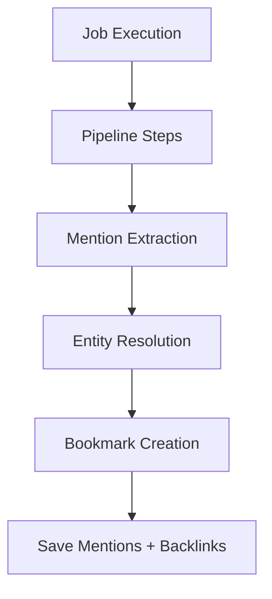

# Storage

The storage layer in ContextHelp gains new responsibilities with the introduction of **Mentions** and the **Entity Graph**.
While it continues to store bookmarks, jobs, traces, and tracking fields, it now additionally supports:

- **mention persistence**
- **entity resolution caching** (optional)
- **reverse lookup indexing** for entity → bookmark relationships

These enhancements preserve the system’s core principles of decentralization, determinism, extensibility, and local-first operation.

---

## Local-First Storage Philosophy

ContextHelp treats local storage as the canonical source of truth for:

- bookmarks
- ingestion jobs
- entity-resolution cache (optional)
- backlink index (entity → bookmarks)

Networked registries enrich the system but do not override or replace local data unless explicitly configured.

Key principles:

- **User Ownership** — All knowledge, including mentions, belongs to the user.
- **Offline First** — Mentions and entities remain usable without network connectivity.
- **Transparent & Inspectable** — Bookmarks and mentions are visible, exportable, and non-proprietary.

---

## Storage Responsibilities

The storage subsystem now handles:

- Persisting **bookmarks**, including:
  - tags
  - hints
  - **mentions**
  - **content hash** (SHA-256 for deduplication)
  - **reinforcement count** and **last reinforced timestamp**
- Maintaining the **entity–bookmark backlink index**
- Maintaining jobs and ingestion traces
- **Content-hash deduplication** — detecting duplicate content via normalized hash lookup
- **Reinforcement tracking** — merging metadata and incrementing encounter count on re-ingestion
- Supporting mention-based filtering and query evaluation

Storage does **not** handle:

- mention extraction (pipeline responsibility)
- entity resolution (resolver + registry client)
- refresh scheduling and feed fetching (jobs)
- ranking or reranking
- pipeline execution

These remain outside the storage layer.

---

## Write Path vs Read Path

ContextHelp maintains a strict architectural separation.

### Write Path (Ingestion + Pipelines)

Pipelines write:

- bookmark record
- mentions
- backlink entries

Flow:

```
Raw Input
 → Job Record
 → Pipeline Execution
 → Mention Extraction
 → Entity Resolution
 → Content-Hash Dedup Check
   → Match found: Reinforce (merge tags/mentions, increment count)
   → No match: Bookmark Creation
 → Backlink Index Update
```

The dedup check uses a SHA-256 hash of normalized content + source. If a match exists, the worker reinforces the existing bookmark (merging new tags and mentions) rather than creating a duplicate. A partial unique index on `content_hash` enforces integrity, and concurrent races are handled via constraint-violation fallback.

Only ingestion workers modify persistent state.

### Read Path (Search + Retrieval)

Query evaluation may include:

- metadata filters
- tag filters
- hint filters
- **mention filters**
- boolean logic
- text search

Storage returns local results; registry layers may merge or enhance them.

---

## Data Model Foundations

### Bookmarks

Bookmarks now include:

```
mentions: ["<entity-id>", ...]
```

`type` is free-form (`"feed"`, `"feed_item"`, ...); storage does not validate it.

Other core fields remain unchanged.

Mentions may reference:

- registry-provided entities
- user-defined local entities
- unresolved entity IDs

### Jobs

Jobs remain unchanged, but job steps may contain step diagnostic data or mention-resolution traces.

### Job Steps

Optional but useful for:

- mention extraction logging
- step debug output
- feed parsing diagnostics

---

## Entity–Bookmark Backlink Index

Local storage introduces or extends a lightweight backlink table enabling:

- efficient mention-based queries
- bidirectional graph navigation

A minimal model:

- `entity_id`
- `bookmark_id`

Backends may optimize or denormalize this.

---

## Storage Backends

`storage.type` selects the driver; `internal/storageutil/factory.go` accepts
only two values and fails startup on anything else.

| `storage.type` | `storage.path` | Vector search |
|---|---|---|
| `sqlite` (default) | database file | `sqlite-vec` `vec0` table, cosine distance |
| `postgres` | connection string | `pgvector`, cosine `<=>` |

Both drivers keep `mentions` as a JSON column on the object row (`JSON` on
SQLite, `JSONB` on PostgreSQL). Content above `storage.blob.threshold` is
written to the blob store set by `storage.blob.backend`: `local` (default),
`s3`, or `garage` (S3 with Garage defaults).

There is no JSON-file backend, no LEANN backend and no custom-backend hook:
adding a backend means adding a case to the factory. See
[embeddings.md](embeddings.md) for vector indexing and
[../scaling.md](../scaling.md) for choosing between the two drivers.

---

## BookmarkStore Interface

Adds support for:

- content-hash deduplication and reinforcement

### Save

Save:

- core bookmark fields
- mentions
- backlink entries
- content hash (computed from normalized raw content + source)
- reinforcement count (initialized to 1)

### GetByContentHash

Lookup by content hash for dedup detection. Returns `nil` for empty hash to guard against matching pre-migration rows.

### Reinforce

Atomic (transactional) operation that:

- merges tags and mentions from new ingestion into existing bookmark
- increments `reinforcement_count`
- updates `last_reinforced_at`
- returns existing bookmark ID

### Update

Update must maintain:

- backlink index integrity

### List

Query filters may include:

- `mention:<id>`
- `type:<type>`

Backends translate AST queries accordingly.

### Delete

Must:

- remove bookmark
- prune backlink entries

### IncrementView / IncrementMatch

Unchanged.

---

## JobStore Interface

Same responsibilities; steps may store arbitrary debug metadata in job steps, which storage treats as opaque.

---

## Indexing and Query Optimization

### JSON Backend

Mention filtering requires full scan:

```
if entity_id in bookmark.mentions:
    include
```

### SQLite / Postgres

Use recommended schema:

```
bookmark_mentions(entity_id, bookmark_id)
```

Bookmark types become simple indexed filters.

Prefix indexing recommended for:

- entity namespaces

---

## Mermaid Diagram: Write Path



---

## Concurrency Model

No changes from traditional context engine requirements.

Rules remain:

- only ingestion workers write
- readers never block writers
- step code must not circumvent single-writer guarantees

---

## Tracking Behavior

Same as before.

---

## Relationship to Registries

Storage does not store registry entity definitions, only IDs.

Rules:

- local entity definitions stored only in entity registry
- mentions store IDs referencing entities
- entity resolution cached optionally
- registry sync never overwrites bookmarks

---

## Importing, Exporting, and Syncing

Exports include:

```
mentions: [...]
```

Imports must:

- restore mentions
- rebuild backlink index
- never run pipelines automatically

---

## Future Enhancements

- hybrid graph + vector retrieval
- encrypted per-field storage

---

## Summary

The Storage layer now provides:

- deterministic ingestion including mention persistence
- **content-hash deduplication** with reinforcement tracking
- entity → bookmark backlink indexing
- optimized mention-aware querying
- strict read/write separation
- registry-safe semantics
